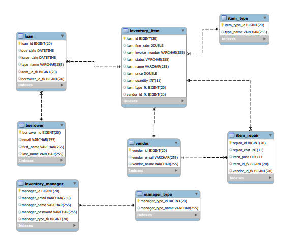

# Inventory Management System

A Spring Boot application for tracking items through lending, issuance, repair and
return, built to replace a paper ledger at a police department equipment store.
Items carry a type and a vendor, borrowers take loans against them, and overdue
returns accumulate a fine at the item's own rate.

> **2021 university project, finished and no longer maintained.** It is kept up
> because people fork it as a Spring Boot and Thymeleaf reference. It is not
> representative of how I build things now. For current work see
> [mehboob.dev](https://mehboob.dev).

## What it covers

| Area | What it does |
| :-- | :-- |
| **Items** | Catalogue of inventory with item types, vendors and available quantity |
| **Issuance** | Issue an item to a borrower and open a loan against it |
| **Return** | Close a loan against an issued item and record the return date |
| **Repair** | Send an item to a vendor for repair and record the cost against it |
| **Fines** | Total a borrower's outstanding fines and record a payment |

The domain model is `Item`, `ItemType`, `Vendor`, `Borrower`, `Loan`,
`ItemRepair`, `InventoryManager` and `ManagerType`. Fines are not an entity of
their own: each item carries a `fineRate`, and the amount owed accumulates on
the `Loan` as `totalFine`.

## Tech stack

Spring Boot 2.5.1 on Java 11, with Spring Data JPA and Hibernate over MySQL,
Thymeleaf for server-rendered views, and Bean Validation on the forms.

## Running it locally

You need Java 11 and a running MySQL server. Create the database:

```sql
CREATE DATABASE IMS;
```

Point the app at it. `application.properties` reads from the environment, so
either export these or edit the file:

```bash
export IMS_DB_URL="jdbc:mysql://127.0.0.1:3306/IMS?useSSL=false&serverTimezone=UTC&useLegacyDatetimeCode=false"
export IMS_DB_USER="root"
export IMS_DB_PASSWORD="your-password"
```

Then start it with the Maven wrapper:

```bash
./mvnw spring-boot:run
```

It serves on [localhost:8086](http://localhost:8086). Hibernate is set to
`ddl-auto=update`, so the schema builds itself on first run.

## Entity relationship diagram

The ERD was developed from the functional requirements:

<p align="center">

</p>

## Prototype walkthrough

A prototype built to settle the screens and the navigation between them:

https://user-images.githubusercontent.com/57248707/122088515-38f7bd00-ce1f-11eb-8bc7-3bdb428f7858.mp4

## License

MIT. See [LICENSE](LICENSE).
